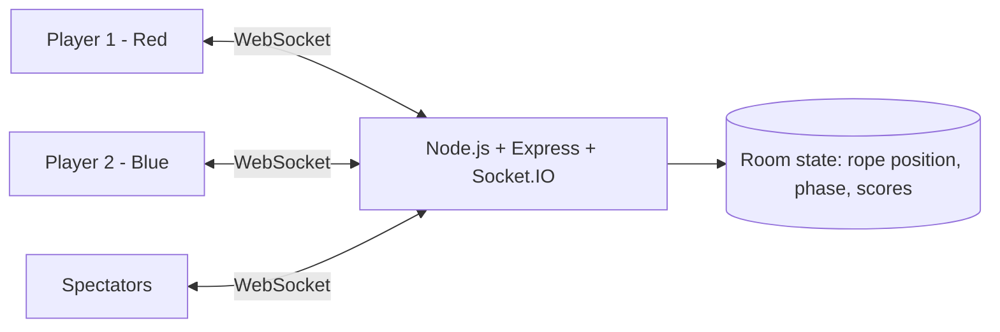

<div align="center">

# 🏆 Online Tug-of-War
### ඔන්ලයින් කඹ ඇදීමේ තරගය

A real-time, 2-player multiplayer tug-of-war game with a Sinhala-language UI, powered by a server-authoritative Node.js backend and a decoupled HTML5 Canvas frontend.


**[🎮 Live Demo](https://game-tug-of-war.vercel.app)**

</div>

---

## Table of Contents

- [Overview](#overview)
- [Features](#features)
- [Tech Stack](#tech-stack)
- [Architecture](#architecture)
- [Project Structure](#project-structure)
- [Getting Started](#getting-started)
- [Configuration](#configuration)
- [Socket Events](#socket-events)
- [Game Lifecycle](#game-lifecycle)
- [Known Limitations and Roadmap](#known-limitations-and-roadmap)
- [Author](#author)
- [License](#license)

## Overview

Two players pull a rope towards their side by pressing **Spacebar** (or tapping the button on mobile). The first team to drag the rope past the goal line wins. Any additional visitors join as live spectators.

The project was built to explore common real-time multiplayer problems: keeping a single source of truth on the server, smoothing out network latency on the client, and handling disconnects without breaking the room for everyone else.

<!--
Add screenshots here once you have them, for example:


-->

## Features

- **Real-time multiplayer** over WebSockets using Socket.IO
- **Server-authoritative game logic**: the backend owns the rope position (-100 to +100), round state, win detection and scores, while clients only render
- **Lobby and roles**: the first player is assigned Red (left), the second Blue (right), and everyone after that becomes a spectator
- **Automatic countdown**: a 3-2-1 countdown starts as soon as both players are connected
- **Smooth rendering**: client-side interpolation (lerp) hides network latency
- **Disconnect handling**: if an active player leaves mid-round, the round resets and a waiting spectator is promoted into the empty seat
- **Anti-spam protection**: role validation and a per-player cooldown on every pull action
- **Animated Canvas graphics**: drifting clouds, a textured rope with a center flag, and 3 stick-figure players per team whose expressions change depending on who is winning
- **Synthesized sound effects** using the Web Audio API (pull, countdown beeps, victory cheer), with no audio files shipped
- **Sinhala UI**: responsive dark futuristic theme with touch-friendly controls
- **Splash screen**: animated logo and loading bar, synchronized so the socket connection (and therefore the countdown) only begins after it finishes

## Tech Stack

| Layer | Technology |
|---|---|
| Backend | Node.js, Express, Socket.IO, CORS |
| Frontend | HTML5 Canvas, vanilla JavaScript, CSS3 |
| Audio | Web Audio API |
| Deployment | Vercel (frontend) |

## Architecture

The frontend and backend are fully decoupled. The frontend is a static app that connects to the backend over a cross-origin WebSocket connection (CORS enabled).



The server is the single source of truth. Clients send actions (`pull`), the server validates them and updates the state, then broadcasts the new state to everyone. Clients interpolate towards the latest state for smooth motion.

## Project Structure

```
tug-of-war/
├── backend/
│   ├── package.json
│   └── server.js
└── frontend/
    ├── index.html
    ├── style.css
    ├── game.js
    ├── splash.js
    └── logo.png
```

## Getting Started

### Prerequisites

- Node.js 16 or newer
- npm

### 1. Clone the repository

```bash
git clone https://github.com/YushanSadeepa/<your-repo-name>.git
cd <your-repo-name>
```

### 2. Start the backend

```bash
cd backend
npm install
npm start
```

The server runs on `http://localhost:3000`.

### 3. Serve the frontend

In a second terminal:

```bash
cd frontend
npx serve .
```

### 4. Play

Open the frontend URL in two browser tabs or devices. The first becomes Red, the second becomes Blue, and the countdown starts automatically. Open a third tab to join as a spectator.

## Configuration

| Setting | Location | Description |
|---|---|---|
| `BACKEND_URL` | `frontend/game.js` | Backend server URL. Defaults to `http://localhost:3000`; change it when deploying the backend elsewhere |
| CORS `origin` | `backend/server.js` | Currently allows all origins (`'*'`). Restrict this to your frontend domain in production |
| `PORT` | environment variable | Backend port. Defaults to `3000` |
| `PULL_IMPULSE`, `PULL_COOLDOWN_MS`, `COUNTDOWN_SECONDS` | `backend/server.js` | Gameplay tuning constants |

## Socket Events

| Event | Direction | Description |
|---|---|---|
| `role` | server → client | Tells a client whether it is `red`, `blue` or `spectator` |
| `state` | server → all clients | Broadcasts phase, rope position, scores, pulling flags and spectator count |
| `pull` | client → server | A player's pull action (validated and rate-limited) |
| `restart` | client → server | Starts a new round after a win |

## Game Lifecycle

```
waiting  →  countdown  →  playing  →  finished
   ↑                                      │
   └──────────── restart / disconnect ────┘
```

1. **waiting**: fewer than two players are connected.
2. **countdown**: both players are present and a 3-2-1 countdown runs.
3. **playing**: pull actions move the rope until it reaches -100 (Red wins) or +100 (Blue wins).
4. **finished**: the winner is announced and either player can start a new round.

## Known Limitations and Roadmap

- A reconnecting player is treated as a new connection. If an active player drops mid-round, the round resets rather than resuming.
- A single shared room is used; the room logic is structured so it can be extended to multiple rooms.
- Planned improvements:
  - Persistent session tokens so a returning player reclaims their seat
  - A short reconnect grace period before resetting the round
  - Multiple concurrent rooms
  - Restricting CORS to a configured frontend origin

## Author

**Yushan Sadeepa**
Computer Science undergraduate, Sabaragamuwa University of Sri Lanka

- GitHub: [@YushanSadeepa](https://github.com/YushanSadeepa)
- LinkedIn: [linkedin.com/in/yushan-sadeepa](https://linkedin.com/in/yushan-sadeepa)
- Portfolio: [portfolio-three-ruby-30.vercel.app](https://portfolio-three-ruby-30.vercel.app)

## License

This project is licensed under the MIT License.
